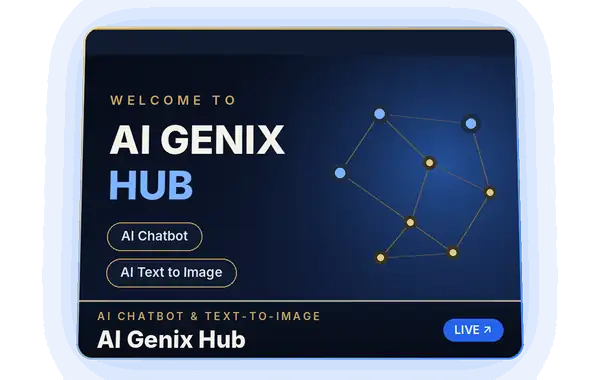

<picture>
  <source srcset="assets/hero-3d.webp" type="image/webp">
  
</picture>

 

 

## About

I am **Tayyab Ali**, known across the developer community as **CodeWithDeved**. I am a **Software Engineer** and the **Founder and CEO at [Vibeans Solutions](https://www.vibeanssolutions.site/)**, based in Karachi, Pakistan. My engineering philosophy centers on the intersection of code architecture and cognitive design, building digital products that align technical performance with how people naturally think, decide, and interact.

- **Founder &amp; CEO**, [Vibeans Solutions](https://www.vibeanssolutions.site/), leading software and product development for AI powered SaaS platforms and modern web applications.
- **Software Engineer**, [Perception Tech](https://perceptiontech.org/), contributing to scalable software systems and web engineering.
- **Engineering Core**: Full stack web application development, Generative AI integration, Retrieval Augmented Generation (RAG), and Prompt Engineering.
- **Domain Focus**: FinTech and Healthcare Technology, where security, cognitive usability, and reliable data workflows are paramount.

> Turning complex technical challenges into intuitive, high impact digital products.

## Featured Products

**Live software products and AI applications developed collaboratively with teams. Select any card to explore the live application.**

<table>
  <tr>
    <td width="50%" align="center" valign="middle">
      
    </td>
    <td width="50%" valign="middle">
      

        
        <h4><a href="https://aigenixhub.netlify.app/">AI Genix Hub</a></h4>
        Multi modal generative AI platform combining conversational intelligence with text to image synthesis, engineered for responsive creative workflows.
          
        
      

    </td>
  </tr>
  <tr>
    <td width="50%" align="center" valign="top">
       
      <h4><a href="https://creatie-hive.vercel.app/">Creaite Hive</a></h4>
      An AI powered design suite helping architects and creators transform concept sketches and imagery into precision architectural designs.  
      
    </td>
    <td width="50%" align="center" valign="top">
       
      <h4><a href="https://docbrio.me/">DocBrio</a></h4>
      A high performance browser based document toolkit to convert, merge, edit, sign, and compress files client side without server uploads.  
      
    </td>
  </tr>
  <tr>
    <td width="50%" align="center" valign="top">
       
      <h4><a href="https://leadster-io.vercel.app/">Leadster.io</a></h4>
      An intelligent conversational agent built for B2B lead discovery, automated prospect research, and verified contact extraction.  
      
    </td>
    <td width="50%" align="center" valign="top">
       
      <h4><a href="https://pakmilkiyat.vercel.app/">PakMilkiyat</a></h4>
      A modern real estate portal providing structured property exploration across residential sales, commercial rentals, and new developments.  
      
    </td>
  </tr>
</table>

Enterprise software and client applications built with teams through Vibeans Solutions. Explore additional studio work at the <a href="https://www.vibeanssolutions.site/#portfolio">Vibeans Solutions portfolio</a>.

## Technical Focus

<table>
  <tr>
    <td width="50%" valign="top">
      <h4>🧠 Generative AI &amp; Intelligent Systems</h4>
      Engineering practical applications leveraging Generative AI, Retrieval Augmented Generation (RAG), and Prompt Engineering to solve real world domain challenges.
    </td>
    <td width="50%" valign="top">
      <h4>🌐 Full Stack SaaS &amp; Web Applications</h4>
      Architecting and shipping responsive, modern web applications from initial product development through production cloud deployment.
    </td>
  </tr>
  <tr>
    <td width="50%" valign="top">
      <h4>🎨 Cognitive Design &amp; User Experience (UX)</h4>
      Applying principles of cognitive design to build digital interfaces that minimize user friction, establish trust, and optimize complex workflows.
    </td>
    <td width="50%" valign="top">
      <h4>💳 FinTech &amp; Healthcare Technology</h4>
      Focusing on high impact software solutions in financial technology and healthcare systems, where data precision, privacy, and seamless user journeys are essential.
    </td>
  </tr>
</table>

## Open Source Repositories

Personal repositories and foundational experiments across web applications, desktop software architecture, and interactive CSS modeling.

<table>
  <tr>
    <td width="50%" valign="top">
      <h4><a href="https://github.com/codewithdeved/AssistAI">AssistAI</a></h4>
      An intelligent assistant web interface built with React.js, JavaScript, HTML5, and CSS3. 
      <b>Primary Language:</b> HTML &bull; React.js
    </td>
    <td width="50%" valign="top">
      <h4><a href="https://github.com/codewithdeved/Course-Management-System">Course-Management-System</a></h4>
      A desktop Course Management System (CMS) engineered in Java utilizing AWT, Swing, and JavaFX. 
      <b>Primary Language:</b> Java
    </td>
  </tr>
  <tr>
    <td width="50%" valign="top">
      <h4><a href="https://github.com/codewithdeved/Employee-Information-System-EIS">Employee-Information-System-EIS</a></h4>
      A database driven Employee Information System (EIS) implemented in Python for record management. 
      <b>Primary Language:</b> Python
    </td>
    <td width="50%" valign="top">
      <h4><a href="https://github.com/codewithdeved/Tesla-Cyber-Truck">Tesla-Cyber-Truck</a></h4>
      An interactive 3D visual rendering of a Tesla Cyber Truck and robot, created with pure CSS3 on React.js. 
      <b>Primary Language:</b> CSS3
    </td>
  </tr>
  <tr>
    <td width="50%" valign="top">
      <h4><a href="https://github.com/codewithdeved/Bugatti">Bugatti</a></h4>
      An intricate 3D vehicle modeling experiment rendered purely through CSS3 transforms on React.js. 
      <b>Primary Language:</b> CSS3
    </td>
    <td width="50%" valign="top">
      <h4><a href="https://github.com/codewithdeved/Harley-Davidson">Harley-Davidson</a></h4>
      An interactive 3D motorcycle model and animation constructed with advanced CSS3 on React.js. 
      <b>Primary Language:</b> CSS3
    </td>
  </tr>
</table>

## Tech Stack

<table>
  <tr>
    <td width="33%" valign="top">
      <h4>💻 Languages &amp; Core</h4>
      
       
      
       
      
      
    </td>
    <td width="33%" valign="top">
      <h4>⚡ Frameworks &amp; Web</h4>
      
       
      
      
    </td>
    <td width="33%" valign="top">
      <h4>🛠️ Tools &amp; Workflow</h4>
      
       
      
      
    </td>
  </tr>
</table>

Technologies verified through public repositories and deployed production products at Vibeans Solutions.

## Languages on GitHub

Language metrics are generated in real time from public repositories via the third party <a href="https://github.com/anuraghazra/github-readme-stats">github-readme-stats</a> service.

## Connect & Collaborate

Whether exploring a technical collaboration, building an AI powered SaaS product, or discussing software engineering opportunities, I welcome your message.

  

 

  

