

<picture>
  <source srcset="assets/hero-3d.webp" type="image/webp">
  
</picture>

 

 

<h2 id="about">About &amp; Engineering Philosophy</h2>

 

<picture>
  <source srcset="assets/about-3d.webp" type="image/webp">
  
</picture>

<h2 id="featured-products">Featured Products &amp; SaaS Portfolio</h2>

 

<picture>
  <source srcset="assets/products-3d.webp" type="image/webp">
  
</picture>

  

**Four production software platforms and AI applications built with teams. Select any application card to launch the live deployment.**

<table>
  <tr>
    <td width="50%" align="center" valign="top">
       
      An AI powered design suite helping architects and creators transform concept sketches and imagery into precision architectural designs.  
      
      
    </td>
    <td width="50%" align="center" valign="top">
       
      A high performance browser based document toolkit to convert, merge, edit, sign, and compress files client side without server uploads.  
      
      
    </td>
  </tr>
  <tr>
    <td width="50%" align="center" valign="top">
       
      An intelligent conversational platform built for B2B lead discovery, automated prospect research, and verified contact extraction.  
      
      
    </td>
    <td width="50%" align="center" valign="top">
       
      A modern real estate portal providing structured property exploration across residential sales, commercial rentals, and new developments.  
      
      
    </td>
  </tr>
</table>

Enterprise software and client applications built with teams through Vibeans Solutions. Explore additional studio work at the <a href="https://www.vibeanssolutions.site/#portfolio">Vibeans Solutions portfolio</a>.

<h2 id="technical-focus">Technical Focus &amp; Capabilities</h2>

 

<picture>
  <source srcset="assets/focus-3d.webp" type="image/webp">
  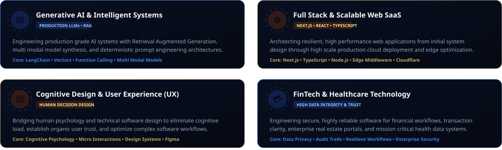
</picture>

<h2 id="open-source-repositories">Open Source Repositories</h2>

 

<table>
  <tr>
    <td width="50%" align="center" valign="top">
      <a href="https://github.com/codewithdeved/AssistAI">
        <picture>
          <source srcset="assets/repos/card-assistai.webp" type="image/webp">
          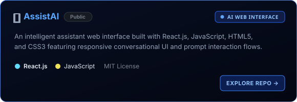
        </picture>
      </a>
    </td>
    <td width="50%" align="center" valign="top">
      <a href="https://github.com/codewithdeved/Course-Management-System">
        <picture>
          <source srcset="assets/repos/card-cms.webp" type="image/webp">
          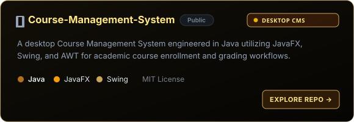
        </picture>
      </a>
    </td>
  </tr>
  <tr>
    <td width="50%" align="center" valign="top">
      <a href="https://github.com/codewithdeved/Employee-Information-System-EIS">
        <picture>
          <source srcset="assets/repos/card-eis.webp" type="image/webp">
          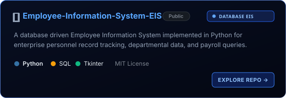
        </picture>
      </a>
    </td>
    <td width="50%" align="center" valign="top">
      <a href="https://github.com/codewithdeved/Tesla-Cyber-Truck">
        <picture>
          <source srcset="assets/repos/card-cybertruck.webp" type="image/webp">
          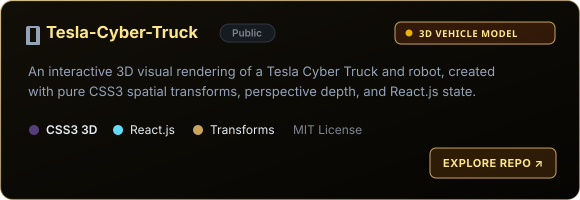
        </picture>
      </a>
    </td>
  </tr>
  <tr>
    <td width="50%" align="center" valign="top">
      <a href="https://github.com/codewithdeved/Bugatti">
        <picture>
          <source srcset="assets/repos/card-bugatti.webp" type="image/webp">
          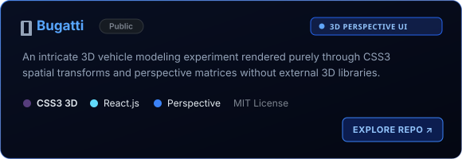
        </picture>
      </a>
    </td>
    <td width="50%" align="center" valign="top">
      <a href="https://github.com/codewithdeved/Harley-Davidson">
        <picture>
          <source srcset="assets/repos/card-harley.webp" type="image/webp">
          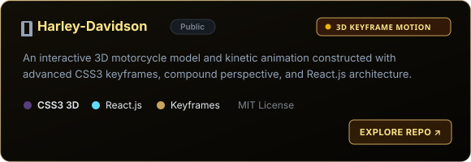
        </picture>
      </a>
    </td>
  </tr>
</table>

<h2 id="tech-stack">Technology Stack &amp; Core Tooling</h2>

 

<picture>
  <source srcset="assets/tech-stack-3d.webp" type="image/webp">
  
</picture>

 

Technologies verified through public repositories and deployed production products at Vibeans Solutions.

<h2 id="languages-activity">Languages &amp; Activity on GitHub</h2>

 

<picture>
  <source srcset="assets/stats-3d.webp" type="image/webp">
  
</picture>

  

<table>
  <tr>
    <td width="50%" align="center" valign="middle">
      
    </td>
    <td width="50%" align="center" valign="middle">
      
    </td>
  </tr>
</table>

Metrics are generated in real time from public repositories via the third party <a href="https://github.com/anuraghazra/github-readme-stats">github-readme-stats</a> and <a href="https://github.com/DenverCoder1/github-readme-streak-stats">streak-stats</a> services.

<h2 id="connect-collaborate">Connect &amp; Collaborate</h2>

 

<picture>
  <source srcset="assets/connect/connect-3d.webp" type="image/webp">
  
</picture>

  

<table>
  <tr>
    <td width="50%" align="center" valign="top">
      <a href="https://www.linkedin.com/in/code-with-deved/">
        <picture>
          <source srcset="assets/connect/card-linkedin.webp" type="image/webp">
          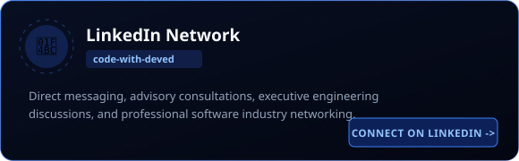
        </picture>
      </a>
    </td>
    <td width="50%" align="center" valign="top">
      <a href="https://www.vibeanssolutions.site/">
        <picture>
          <source srcset="assets/connect/card-vibeans.webp" type="image/webp">
          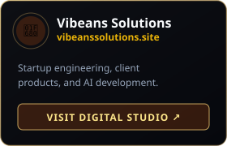
        </picture>
      </a>
    </td>
  </tr>
  <tr>
    <td width="50%" align="center" valign="top">
      <a href="https://github.com/codewithdeved">
        <picture>
          <source srcset="assets/connect/card-github.webp" type="image/webp">
          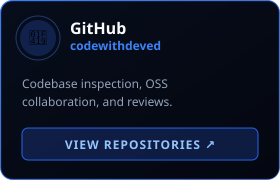
        </picture>
      </a>
    </td>
    <td width="50%" align="center" valign="top">
      <a href="https://www.linkedin.com/in/code-with-deved/">
        <picture>
          <source srcset="assets/connect/card-inquiries.webp" type="image/webp">
          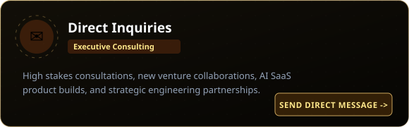
        </picture>
      </a>
    </td>
  </tr>
</table>

 

 

  

<picture>
  <source srcset="assets/footer-3d.webp" type="image/webp">
  
</picture>

