

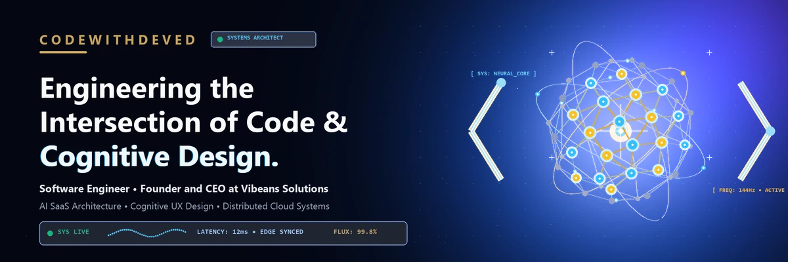

 

 

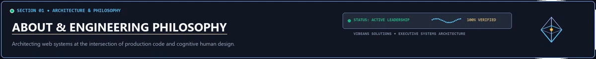

 

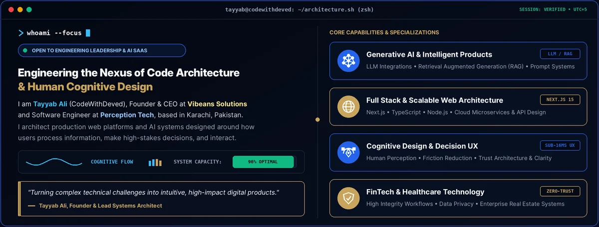

 

  
  
  

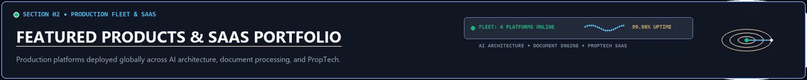

 

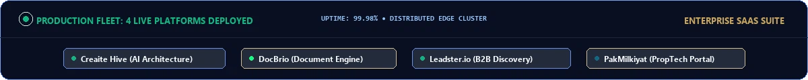

 

**Four production software platforms and AI applications built with teams. Select any application card to launch the live deployment.**

<table width="100%">
  <tr>
    <td width="50%" align="center" valign="top">
      <a href="https://creatie-hive.vercel.app/">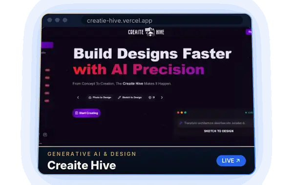</a> 
      An AI powered design suite helping architects and creators transform concept sketches and imagery into precision architectural designs.  
      
      
    </td>
    <td width="50%" align="center" valign="top">
       
      A high performance browser based document toolkit to convert, merge, edit, sign, and compress files client side without server uploads.  
      
      
    </td>
  </tr>
  <tr>
    <td width="50%" align="center" valign="top">
      <a href="https://leadster-io.vercel.app/">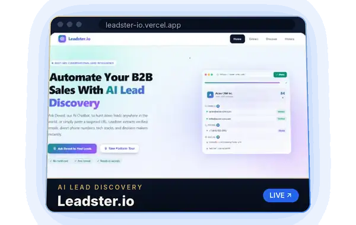</a> 
      An intelligent conversational platform built for B2B lead discovery, automated prospect research, and verified contact extraction.  
      
      
    </td>
    <td width="50%" align="center" valign="top">
       
      A modern real estate portal providing structured property exploration across residential sales, commercial rentals, and new developments.  
      
      
    </td>
  </tr>
</table>

Enterprise software and client applications built with teams through Vibeans Solutions. Explore additional studio work at the <a href="https://www.vibeanssolutions.site/#portfolio">Vibeans Solutions portfolio</a>.

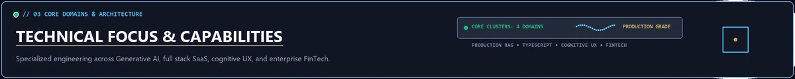

 

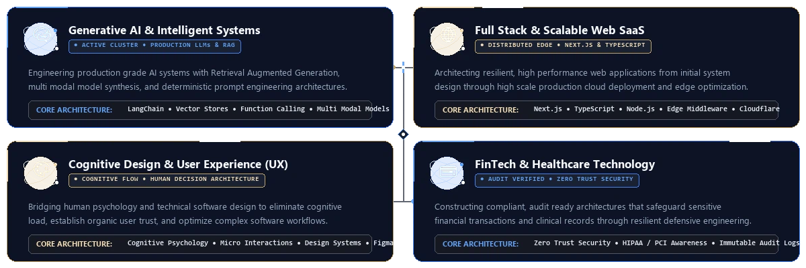

 

  
  
  

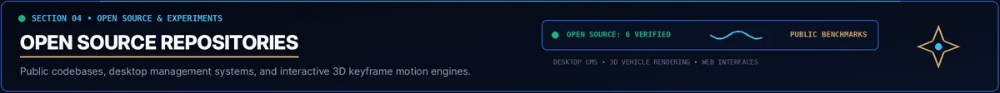

 

<table width="100%">
  <tr>
    <td width="50%" align="center" valign="top">
      <a href="https://github.com/codewithdeved/AssistAI">
        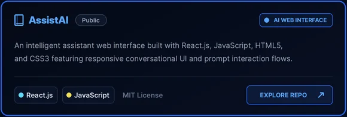
      </a>
       
      
      
    </td>
    <td width="50%" align="center" valign="top">
      <a href="https://github.com/codewithdeved/Course-Management-System">
        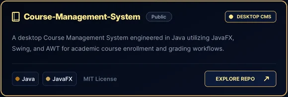
      </a>
       
      
      
    </td>
  </tr>
  <tr>
    <td width="50%" align="center" valign="top">
      <a href="https://github.com/codewithdeved/Employee-Information-System-EIS">
        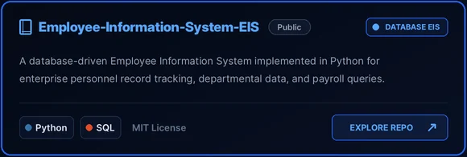
      </a>
       
      
      
    </td>
    <td width="50%" align="center" valign="top">
      <a href="https://github.com/codewithdeved/Tesla-Cyber-Truck">
        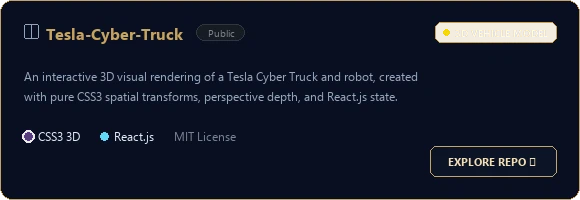
      </a>
       
      
      
    </td>
  </tr>
  <tr>
    <td width="50%" align="center" valign="top">
      <a href="https://github.com/codewithdeved/Bugatti">
        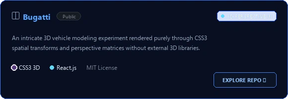
      </a>
       
      
      
    </td>
    <td width="50%" align="center" valign="top">
      <a href="https://github.com/codewithdeved/Harley-Davidson">
        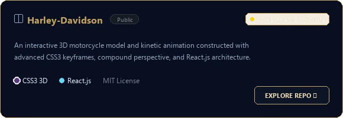
      </a>
       
      
      
    </td>
  </tr>
</table>

 

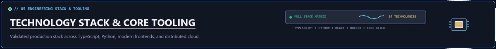

 

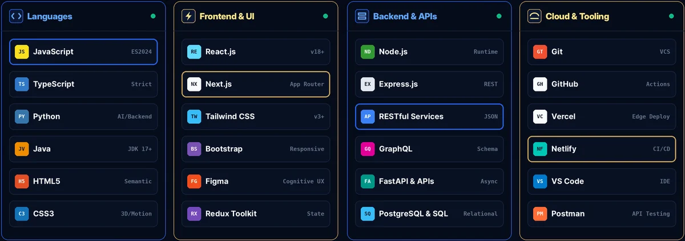

 

Technologies verified through public repositories and deployed production products at Vibeans Solutions.

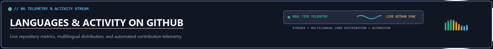

 

 

<table width="100%">
  <tr>
    <td width="50%" align="center" valign="middle">
      
    </td>
    <td width="50%" align="center" valign="middle">
      
    </td>
  </tr>
</table>

Metrics are generated in real time from public repositories via third party services.

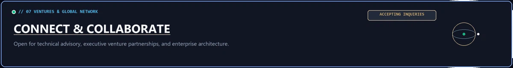

 

 

<table width="100%">
  <tr>
    <td width="50%" align="center" valign="top">
      <a href="https://www.linkedin.com/in/code-with-deved/">
        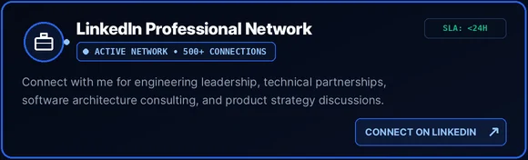
      </a>
       
      
    </td>
    <td width="50%" align="center" valign="top">
      
       
      
    </td>
  </tr>
  <tr>
    <td width="50%" align="center" valign="top">
      <a href="https://github.com/codewithdeved">
        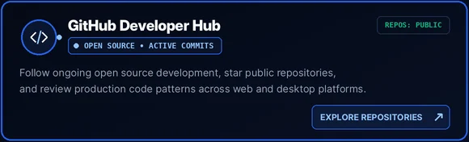
      </a>
       
      
    </td>
    <td width="50%" align="center" valign="top">
      <a href="https://www.linkedin.com/in/code-with-deved/">
        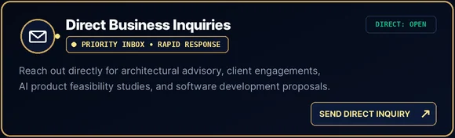
      </a>
       
      
    </td>
  </tr>
</table>

 

 

 

